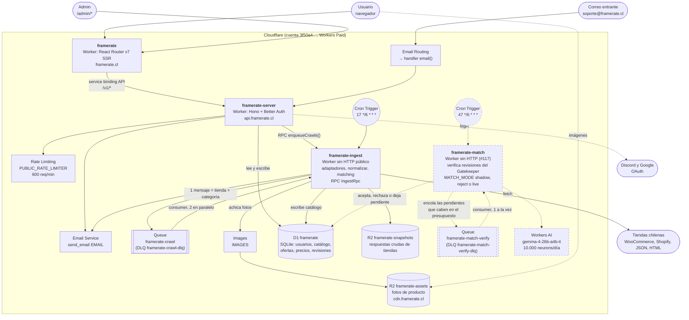
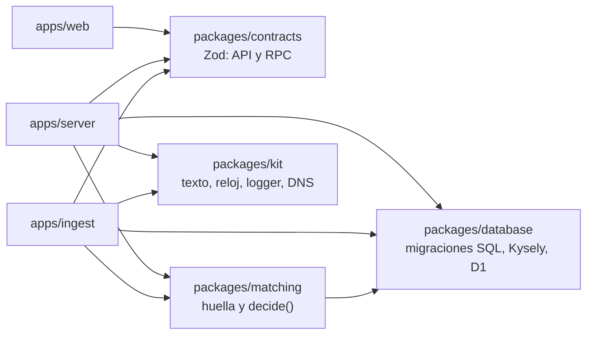

# Arquitectura de Framerate (v2)

Reconstrucción desde cero del backend. Objetivo: **datos correctos antes que
datos completos**, despliegue barato en Cloudflare (tope US$10/mes) y código
organizado por *feature*, no por tipo de archivo.

> Estado: en producción desde septiembre de 2026. El sistema anterior (Supabase, seis servicios en Bun y Docker)
> se retiró del repo el 30-09-2026 y sólo queda en el historial de git.

---

## 1. Qué salió mal antes (y qué regla lo evita ahora)

| Problema del sistema anterior | Regla nueva |
|---|---|
| El mismo producto aparecía varias veces y no se podía fusionar. | Matching por **huella en capas** con evidencia guardada y revisión humana para casos dudosos (§5). |
| Se fusionaban productos distintos (ej. 8GB y 16GB). | **Vetos duros** por atributos discriminantes: si difieren, nunca se fusiona, ni con MPN igual. |
| Crawlers inventaban MPN (`TECTEC-slug`) y usaban EAN como MPN. | Los adaptadores **nunca inventan identificadores**; MPN/GTIN se validan (checksum) y ante duda son `null`. |
| Datos basura entraban a la base y no había cómo limpiarlos. | **Validación en la frontera** (Zod + reglas de negocio). Lo inválido va a `quarantine` con su motivo, nunca a `listings`. |
| Disk IO de Supabase agotado. | `price_points` guarda **sólo cambios**; polling reemplazado por Cron + Queues; D1 cobra por filas, no por IO. |
| 6 servicios, 3 runtimes, Docker, colas en Postgres. | **Dos Workers** (API e ingesta) sobre una sola base D1, con Cron + Queues (§2). |
| Lógica mezclada entre apps ("spaghetti"). | Organización por **feature** con dominio puro separado de IO (§3). |
| Un crawl parcial vaciaba el catálogo de una tienda. | **Guardia de salud**: si una corrida trae < 50% de lo esperado no desactiva nada; si trae 0, falla. |

## 2. Vista general

Cuatro Workers con responsabilidades separadas, que comparten la misma base D1. Lo punteado es `framerate-match`
(#117), que todavía no está desplegado.
Cada caja dice el nombre real del recurso en Cloudflare y su tecnología.



Código compartido (las apps no se importan entre sí):



Por qué dos y no uno: un bug o un deploy del scraping no toca la API pública; y
cada Worker sólo tiene los permisos que usa (la API no ve la cola ni los
snapshots; `ingest` no recibe tráfico público). Cuesta lo mismo: Workers no cobra
por cantidad de Workers.

`framerate-match` (#117) está aparte por lo mismo: si Workers AI falla o se acaba el presupuesto diario de neurons,
los crawls siguen y las revisiones esperan. No depende de `ingest`: su Cron corre 30 minutos después del de los
crawls y barre las revisiones pendientes sin veredicto, así que también cubre las que ya existían.

`apps/web` (React Router en Workers) consume `/v1/*` y comparte tipos vía
`@framerate/contracts`.

### Tipos de trabajo de scraping

| Tipo | Disparo | Qué hace | Estado |
|---|---|---|---|
| **Descubrir** | Cron cada 6 h | Recorre el catálogo completo de cada tienda/categoría. Pesado. | ✅ |
| **Bajo demanda** | Admin → `POST /v1/admin/crawls` → RPC a `ingest` | Igual que descubrir, para una tienda/categoría. | ✅ |
| **Refrescar** | Cron frecuente | Re-chequea sólo URLs ya conocidas (precio/stock). Liviano. | pendiente |

## 3. Estructura del código

```
apps/
  server/                       API HTTP (Worker "framerate-server")
    src/
      index.ts                  entrada: sólo fetch
      app.ts                    composición HTTP (monta routers de features)
      env.ts                    bindings del Worker
      features/
        catalog/                lectura pública: listado, búsqueda, detalle, historial
        identity/               login (Better Auth), sesión, perfil, roles y sanciones
        stores/                 perfil de tienda, miembros y reseñas
        claims/                 reclamo de tiendas por DNS (ver stores.md)
        support/                tickets de soporte (usuarios y anónimos con token) y bandeja del personal
        users-admin/            admin: buscar usuarios, suspender, cambiar rol
        crawl-admin/            admin: historial de corridas y cuarentena, "crawlear ahora"
        match-review/           admin: cola de revisión humana de matches
      shared/http/              errores, auth de admin, rate limit, cache
    test/                       integración contra D1 real (Miniflare)
  ingest/                       Scraping (Worker "framerate-ingest")
    src/
      index.ts                  entrada: scheduled (Cron) + queue + RPC (IngestRpc)
      features/ingestion/
        domain/normalize.ts     contrato RawOffer + validación + limpieza (puro)
        stores/                 un adaptador por tienda + cliente HTTP + registro
        crawl-category.ts       caso de uso: una corrida (tienda, categoría)
        ingestion.repository.ts
        runtime.ts              cableado con Cron/Queues/R2 y pedido de crawls
    test/
packages/
  contracts/                    esquemas Zod de la API + contrato RPC server↔ingest
  database/                     migraciones SQL, tipos Kysely, cliente D1, utilidades de test
  matching/                     huella de producto, decisión de matching, repositorio
  kit/                          texto, reloj y logger (sin dependencias)
```

Reglas:

1. **Una feature es dueña de sus tablas.** `ingest` escribe `listings`,
   `price_points`, `crawl_runs`, `quarantine`, y (vía `matching`) `products`,
   `product_identifiers`, `match_*`; `server` escribe usuarios, cotizaciones,
   comentarios, etc., y sólo *resuelve* revisiones de matching.
2. **`domain/` es puro**: sin D1, sin `fetch`, sin `Date.now()`. Se prueba sin
   mocks. El tiempo se inyecta (`Clock`).
3. **Casos de uso** (`crawl-category.ts`, `matchListing`) orquestan dominio
   + repositorio. Reciben sus dependencias como parámetros.
4. **Las apps no se importan entre sí.** Lo compartido vive en `packages/`; la
   única conversación `server` → `ingest` es el RPC tipado de
   `contracts/ingest.ts` (la API no conoce las tiendas ni la cola).
5. **`packages/database` es dueño del esquema.** Una migración afecta a ambos
   Workers; los tests de invariantes viven ahí.
6. Sin DI containers ni registries mágicos: funciones y objetos planos.

## 4. Modelo de datos (D1)

El modelo completo (identidad, organizaciones, tiendas y reseñas, cotizaciones,
comentarios, moderación, soporte y analítica), derivado de las funcionalidades
de la web, está en **[data-model.md](./data-model.md)**. Resumen del núcleo de catálogo:

| Tabla | Qué es | Invariantes clave |
|---|---|---|
| `stores` | Tiendas (se crean solas desde el registro en código). | `slug` único. |
| `listings` | Lo que vende UNA tienda. | `UNIQUE(store_id, external_id)`; `price_card >= price_cash > 0`. |
| `price_points` | Historial: **sólo cuando cambia** precio o stock. | — |
| `products` | Producto canónico que agrupa ofertas. | `slug` único; `attribute_key` indexada. |
| `product_identifiers` | MPN/GTIN normalizados de cada producto. | **PK (kind, value)**: un identificador pertenece a un solo producto. |
| `match_decisions` | Auditoría append-only de cada vínculo/desvínculo. | — |
| `match_reviews` | Casos dudosos para revisión humana. | Una revisión pendiente por oferta. |
| `crawl_runs` | Una corrida por (tienda, categoría) con estadísticas. | — |
| `quarantine` | Ofertas rechazadas con motivo y payload. | — |
| `products_fts` | Búsqueda FTS5 (sin tildes), sincronizada por triggers. | — |

Escrituras idempotentes: si la cola reintenta una corrida, el resultado es el
mismo. Oferta + punto de precio se escriben en un `batch` (atómico en D1).

## 5. Matching (huella de producto)

El matching es **IA primero** (#153, #156): ninguna oferta se vincula por regex. Flujo por oferta:

1. **Ingest** guarda la oferta oculta (`visible = 0`, `norm_status = pending`) y la encola en `framerate-normalize`
   cada vez que nace o cambia su `norm_hash`. La corrida no decide vínculos.
2. **Normalize** (Haiku) devuelve la identidad anclada al texto (`listing_identity`: marca, nombre canónico,
   atributos por categoría, MPN), más `same_as` (el candidato del catálogo que es el mismo producto, entre los que
   se le mostraron: dueño del MPN/GTIN, producto actual y FTS) y `duplicate_candidates` (fichas del catálogo que son
   el mismo producto entre sí; se fusionan ahí mismo salvo MPNs disjuntos). Encola el vínculo en `framerate-link`.
3. **Match** (`matchListing`) decide con la huella que sale de la identidad (`fingerprintFromIdentity`):
   - **Vetos estructurales** ganan a todo: categoría, marca, capacidad, VRAM, color dicho, V2/CSM, códigos de
     modelo en conflicto (`nv1`/`nv3`), MPN/GTIN en conflicto y `forbid` manual. Los campos de texto libre (línea
     de GPU, serie de SSD, modelo de cooler…) no vetan: producen `textMismatch`, que sólo bloquea el vínculo
     automático por atributos.
   - **`same_as`** de Haiku es el vínculo principal si no hay veto.
   - Sin `same_as`: identificador igual → vínculo; clave de atributos igual sin `textMismatch` → vínculo, salvo que
     Haiku ya hubiera visto y descartado ese candidato (va a revisión); zona gris → producto propio + `match_review`.
   - Una oferta ya vinculada se mueve sólo si `same_as` apunta a otro producto sin veto, o si aparece un veto.
4. La oferta se **publica** al quedar vinculada. Lo que Haiku no procesó en 24 h lo reencola el Cron de ingest
   (`pending`/`normalized` viejos); lo `failed` no es un componente y no vuelve. Un vínculo con revisión pendiente
   de más de 24 h se publica igual (`publishOverdue`).
5. El **detector** (`apps/match/src/detect.ts`) agrupa productos con la misma clave de atributos y propone
   revisiones de fusión con la huella de las identidades, sin `textMismatch`.

La huella guardada en `products` es la verdad: `loadCandidates` no la recalcula desde el nombre (sólo deriva una
de lectura si el producto no tiene atributos). Los extractores por regex de `attributes.ts` y `buildFingerprint`
quedan como ayuda: compuertas de cuarentena en `normalizeOffer` (`REQUIRED_ATTRIBUTES`), anclaje de la identidad al
texto y huella de una oferta sin identidad. Vocabulario canónico en `packages/matching/src/domain/vocabulary.ts`.

Principio: **preferimos duplicados antes que fusiones erróneas.** Un duplicado
se arregla revisando (o lo fusiona Haiku al ver los dos); una fusión errónea mezcla precios en silencio.

**Se mide** con el gold de identidades reales (`apps/match/test/gold-identity.test.ts`): falla si suben las
fusiones erróneas o baja el recall, y sus topes sólo se mueven en la buena dirección en el mismo commit que mejora
el matching.

**Hash de imagen (pendiente, ADR-4):** se agregará como evidencia *positiva*
dentro de la zona gris (nunca decide sola, porque variantes distintas comparten
foto del fabricante).

### Huella multicapa

La primera entrega (capas 1 y 2, recálculo y medición) está en
[specs/2026-10-02-huella-multicapa-1.md](./specs/2026-10-02-huella-multicapa-1.md). Lo que sigue: hash de imagen
(capa 4) y overrides persistentes.

Es un concepto interno: el usuario nunca lo ve. La huella evalúa señales por capas, de la más confiable a la más
difusa, para decidir si ofertas de tiendas distintas son el mismo producto:

| Capa | Señales | Qué existe hoy |
|---|---|---|
| 1. Identificadores exactos | UPC, EAN, MPN | `product_identifiers` (PK `(kind, value)`). UPC y EAN se guardan como **GTIN-14**: son el mismo espacio de códigos, así un UPC y su EAN coinciden solos. `listings.mpn`/`gtin` guardan lo que publicó cada tienda |
| 2. Texto normalizado | Marca, modelo, variante, capacidad | `fingerprint.ts` (tokens, marca canónica, marca del título en GPU y placas) y `attributes.ts` (atributos por categoría, con color, sufijo de modelo, línea, RGB, variante, revisión y formato); `listings.raw_title` conserva el título crudo para volver a extraer |
| 3. Especificaciones | Chip, VRAM, frecuencia, conectividad | Atributos discriminantes = vetos duros. `products.specs` / `product_spec_values` existen pero todavía no se llenan |
| 4. Imágenes | pHash/dHash (Hamming), similitud visual | `listings.image_urls` guarda todas las fotos; falta el hash |
| 5. Evidencia contextual | Categoría, fabricante, historial | Bloqueo por categoría + marca (veto); historial append-only en `match_decisions` |

Reglas (ya decididas):

- La capa 1 manda: un identificador igual es vínculo casi seguro, salvo veto de la capa 3.
- Sólo se comparan ofertas de la misma categoría y marca (bloqueo), no todo contra todo.
- Un atributo crítico distinto (VRAM, capacidad, velocidad, chip…) es veto, aunque el texto o la imagen coincidan.
- La imagen sólo suma o resta puntaje; nunca decide sola.
- Score combinado con dos umbrales: alto = fusión automática, intermedio = revisión humana, bajo = distintos.
  Precisión antes que recall.
- Trazabilidad: cada vínculo guarda score, capa o método que decidió, y fecha (`match_decisions`).
- Overrides manuales persistentes (forzar o prohibir) que el siguiente crawl no pise.
- Fusiones reversibles.

**Huecos respecto del modelo actual** (ninguno bloquea lo construido; se resuelven al implementar la huella):

1. **Overrides persistentes.** Rechazar una revisión no impide que el mismo par se vuelva a proponer, o que se
   fusione solo si mejora un extractor. Y un vínculo manual se deshace si aparece un veto cuando la tienda cambia el
   título. Falta una tabla `match_overrides (listing_id, product_id, kind: force | forbid)` que `decide` respete.
2. **Fusiones reversibles.** Hoy "fusionar" es mover ofertas de un producto a otro (`accept` mueve la oferta y sus
   identificadores), así que revertir es devolverlas. `match_decisions` guarda el `previousProductId`, pero falta
   la operación "separar" en el admin.
3. ~~Recalcular huellas.~~ Resuelto al revés: la huella guardada manda y se corrige desde la identidad de Haiku
   (`recanonize-products.ts`), nunca desde el nombre.
4. **Umbrales por categoría.** `THRESHOLDS` es global; el score configurable probablemente necesite perfiles por
   categoría (junto con `PROFILES` en `attributes.ts`).
5. **Procedencia de los identificadores.** `product_identifiers` no dice qué oferta aportó cada código; se deduce
   de `listings.mpn`/`gtin`. Alcanza mientras cada oferta guarde lo que publicó.
6. ~~Política de MPN en el título.~~ Resuelto en `normalize` con `codesInTitle` (formas explícitas, el campo de la
   tienda siempre gana). Sigue pendiente el SKU con prefijo (ver [store-candidates.md](./store-candidates.md)).

## 6. Agregar una tienda

1. Identificar la plataforma (WooCommerce → `createWooCommerceAdapter`; si no,
   escribir un adaptador que implemente `StoreAdapter`). Revisar primero
   [store-candidates.md](./store-candidates.md): qué significa cada precio en esa
   tienda (`cardMarkup`) y si su SKU es del fabricante (`sku`).
2. Agregar la entrada en `apps/ingest/src/features/ingestion/stores/registry.ts`.
3. Guardar respuestas reales como fixture y testear el mapeo.
4. Evaluar en local: `bun run --cwd apps/ingest dry-run <tienda>` (crawl real + `normalize`: cobertura de MPN,
   precios, marcas desconocidas y cuarentena).
5. Verificar en producción: `POST /v1/admin/crawls {"store":"x","category":"gpu"}`,
   luego revisar `GET /v1/admin/crawls` y `GET /v1/admin/quarantine`.

Reglas del adaptador (ver `apps/ingest/src/features/ingestion/stores/adapter.ts`): sólo extrae datos crudos, nunca
inventa identificadores, siempre guarda snapshot.

Si la tienda corta las IPs de Cloudflare (403 o captcha por origen, no por lo que hacemos), `egress: "relay"` en su
definición y su dominio en `apps/relay/src/hosts.ts`: el `fetch` del adaptador sale por `relay.nozz.skin` (un
`Bun.serve` en Docker en el servidor del dueño, con token y lista de dominios) y, si el relay no responde, directo. El
relay no resuelve desafíos anti-bot ni cambia el user agent (#154).

## 7. Operación

```bash
# Requisitos: plan Workers Paid (los crawls superan los 10 ms de CPU del plan Free) y R2 activado.
# Usar wrangler >= 4.144 (`bunx wrangler@latest`): la 4.63 falla al crear colas.

# Una vez
bunx wrangler d1 create framerate          # pegar database_id en los 3 wrangler.jsonc:
                                           #   packages/database, apps/server, apps/ingest
bunx wrangler r2 bucket create framerate-snapshots
bunx wrangler r2 bucket lifecycle add framerate-snapshots snapshots-14d snapshots/ --expire-days 14
# Fotos de producto: el Cron de ingest las achica una vez (binding de Images, WebP de 800 px) y cdn.framerate.cl
# las sirve tal cual. No hace falta activar las transformaciones por URL en la zona.
bunx wrangler r2 bucket create framerate-assets --location enam
bunx wrangler r2 bucket domain add framerate-assets --domain cdn.framerate.cl --zone-id <zone id de framerate.cl>
bunx wrangler queues create framerate-crawl
bunx wrangler queues create framerate-crawl-dlq

# Cada cambio de esquema (afecta a ambos Workers)
bun run db:migrate:remote

# Historia de precios (product_price_daily, best_price, reference_price) desde price_points. Ingest la mantiene
# tras cada corrida; esto se corre una vez al desplegar ese cambio, o para reparar días. Es idempotente.
cd packages/database && bunx wrangler d1 execute framerate --remote --file=scripts/backfill-price-daily.sql

# Deploy (sin CI: desde la máquina del desarrollador) — ingest primero: server lo referencia por service binding.
# server queda en https://api.framerate.cl (custom domain en su wrangler.jsonc).
bun run --cwd apps/ingest deploy
bun run --cwd apps/server deploy
cd apps/server && bunx wrangler secret put ADMIN_TOKEN

# Local
bun run db:migrate:local
bun run dev:server            # API
bun run dev:ingest            # scraping (Cron/Queue/RPC)
bunx turbo run check-types test --filter=server --filter=ingest \
  --filter=@framerate/kit --filter=@framerate/database \
  --filter=@framerate/matching --filter=@framerate/contracts
```

Observabilidad: logs JSON estructurados (Workers Logs) con `feature`, `store`,
`category`, `runId`. Salud por tienda en `crawl_runs.stats`.

## 8. Costos estimados (a volumen actual)

| Ítem | US$/mes |
|---|---|
| Workers Paid (incluye D1, Queues, R2 free tier, Cron) | 5,00 |
| D1: 50M filas escritas y 25 mil millones leídas incluidas | 0 |
| Queues: 1M operaciones incluidas (≈ 280 mensajes/día) | 0 |
| R2: 10 GB incluidos (snapshots gzip, retención 14 días; fotos de producto ≈ 1 GB) | 0 |
| Images (plan Free): 5.000 transformaciones únicas al mes; cada foto se procesa una sola vez, al copiarla | 0 |
| **Total** | **≈ 5** |

Pendientes que pueden sumar: Browser Rendering para tiendas que requieren
JavaScript (10 h/mes incluidas, luego US$0,09/h) y LLM si se agrega extracción
asistida.

## 9. Decisiones (ADR resumidos)

- **ADR-1 · D1 en vez de Postgres/Supabase.** Costo por uso, sin IO budget, sin
  servidor. Se pierde RLS: la autorización vive en la API (única que accede a
  la base). Límites de D1 (10 GB, un escritor) holgados para este volumen.
- **ADR-2 · Dos Workers (API e ingesta) sobre una base compartida.** Empezó como
  un solo Worker con tres disparadores; se separó porque el scraping y la API
  tienen ciclos de deploy, permisos y límites distintos (CPU de 120 s por crawl
  vs. respuestas de milisegundos) y mezclarlos ampliaba el radio de daño de
  cualquier cambio. El costo es idéntico. Se comunican sólo por RPC tipado
  (`contracts/ingest.ts`) y por la base. Un Worker extra para el navegador
  (ADR-5) encajaría igual: consume la misma cola.
- **ADR-3 · SQL a mano + Kysely como query builder tipado.** Las migraciones son
  revisables y aplican con `wrangler`. Los tests corren esas migraciones en D1
  real, así el esquema TS no puede desfasarse sin romper CI.
- **ADR-4 · Hash de imagen como evidencia secundaria**, no como llave. Pendiente
  de prueba de concepto (decodificar imágenes en Workers).
- **ADR-5 · Tiendas que requieren navegador**: primero buscar su API JSON; si no
  existe, Browser Rendering; si las bloquea, un job externo (GitHub Actions)
  que envía `RawOffer` a un endpoint admin. Se decide por tienda con datos.

## Plan

1. ✅ Base: esquema D1, contrato de tienda, pipeline de ingesta, matching con revisión, API de catálogo, tests
   contra D1 real.
2. ✅ Modelo de datos completo (migraciones 0001–0008) e identidad (Better Auth + Discord, perfil, roles,
   sanciones; ver [identity.md](./identity.md)).
3. ✅ Separación en `apps/server` + `apps/ingest` con paquetes compartidos y RPC entre ambos.
4. ✅ Tiendas: reclamo por DNS, perfil, miembros y reseñas (ver [stores.md](./stores.md)).
5. ✅ `apps/web` sobre la API v2: login, perfil, catálogo, tiendas, admin de usuarios y revisión de matches.
6. ✅ Legado retirado del repo (30-09-2026).
7. ✅ TecTec y Dust2 verificadas con datos reales: precio tarjeta por recargo verificado, SKU correcto, extractores
   ajustados con la cuarentena real. Las listas sólo muestran productos con stock.
8. ✅ **Resumen de precios** tras cada corrida (`database/src/price-summary.ts`): `products.best_price`,
   `offer_count`, `reference_price` (promedio del mínimo diario entre hoy−32 y hoy−3, con 3 días o más) y
   `product_price_daily`. Backfill desde `price_points`: `database/scripts/backfill-price-daily.sql`.
9. **Más tiendas**, en el orden de [store-candidates.md](./store-candidates.md) (MyShop y Sandos primero).
10. **Huella multicapa** (§5): overrides persistentes, separar fusiones, recalcular huellas, hash de imagen.
11. **Refresco liviano** de precio y stock de URLs conocidas (hoy hay hasta 6 h de atraso).
12. Features de usuario sin backend todavía (el esquema existe): cotizaciones, comentarios, soporte, reportes y
    moderación, alertas de precio. La web aún tiene pantallas de cotización con tipos heredados
    (`shared/utils/db-types.ts`, `features/quote/services/quotes.ts`) que se reemplazan por `@framerate/contracts`
    al construirlas.
